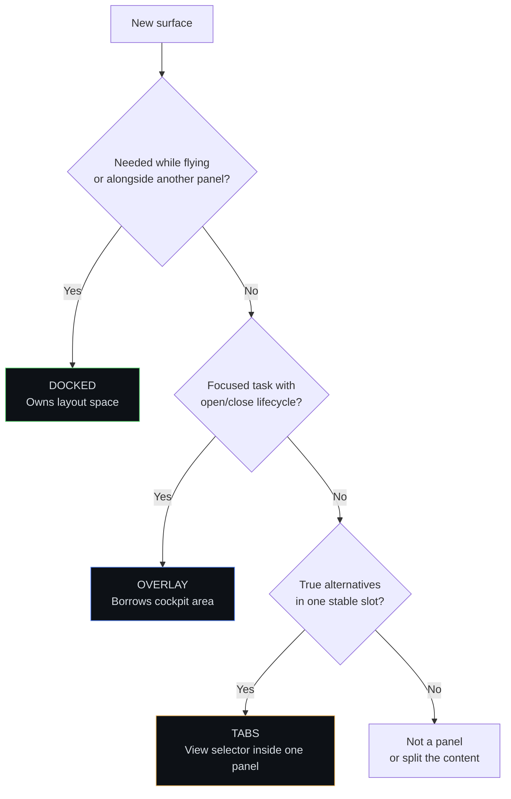
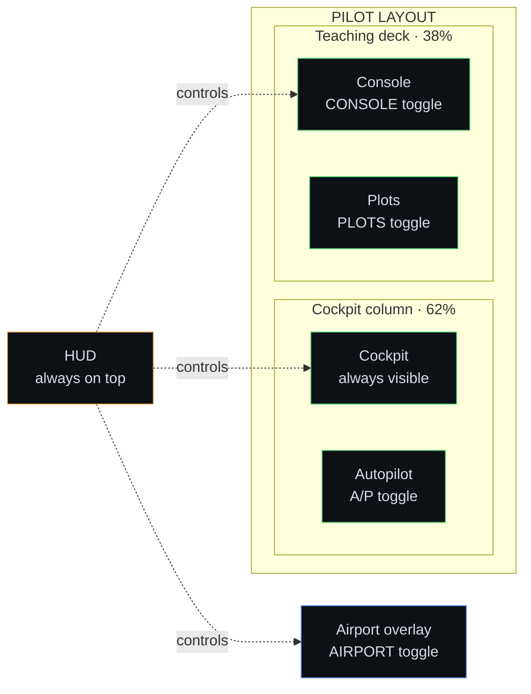
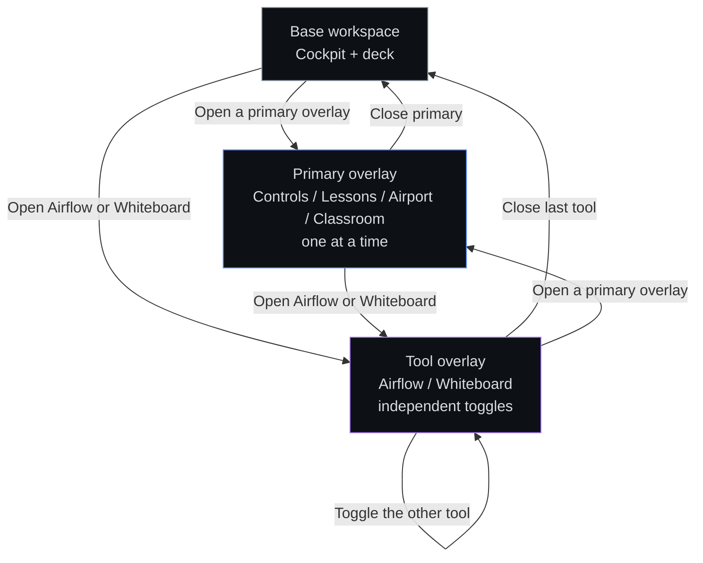
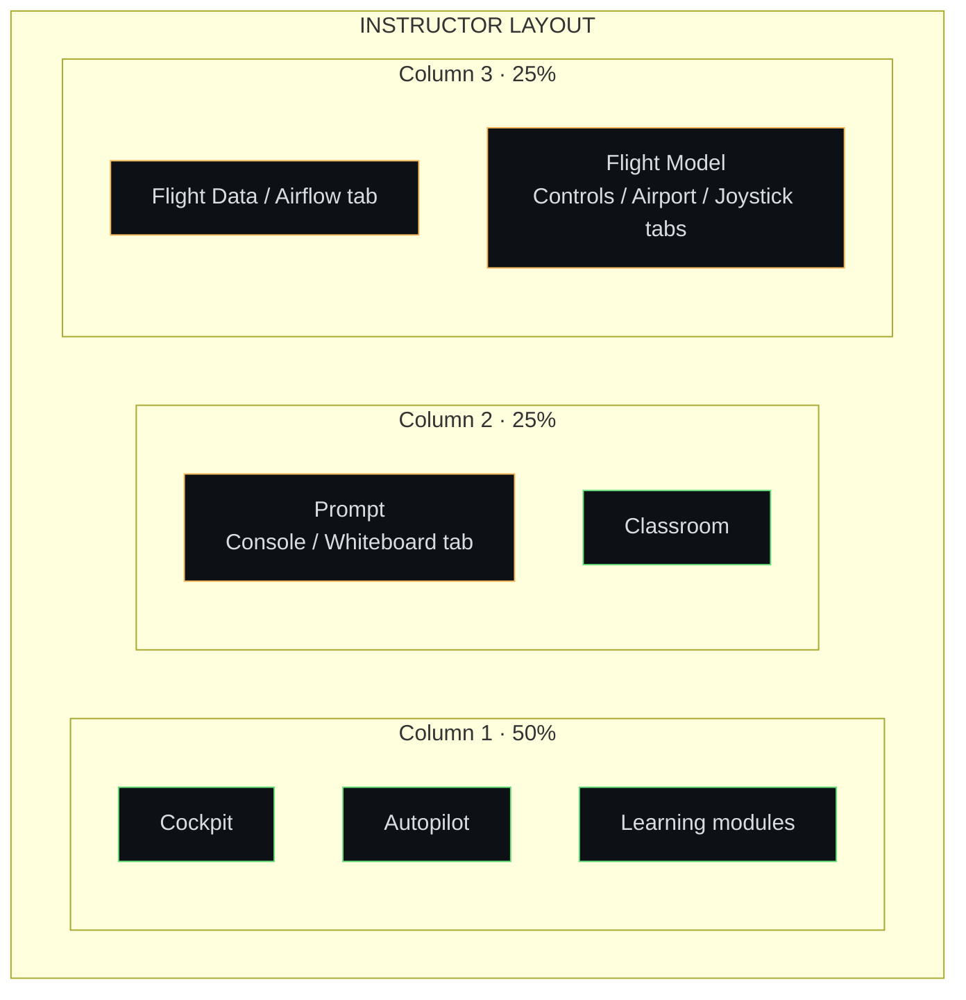
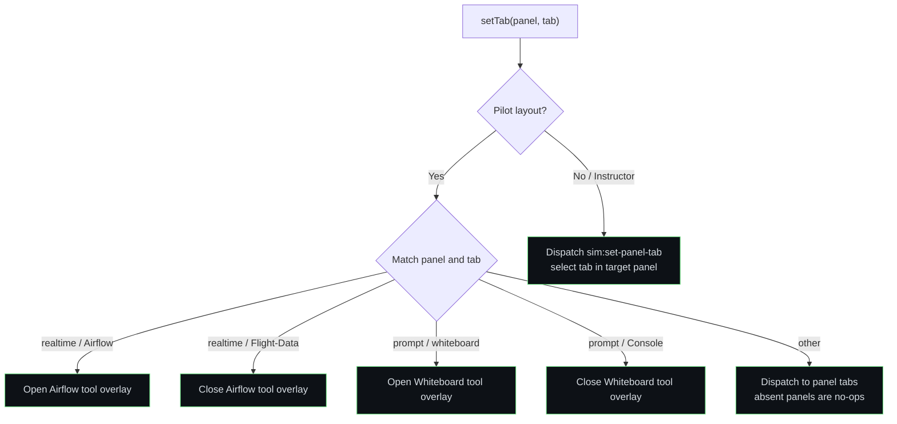
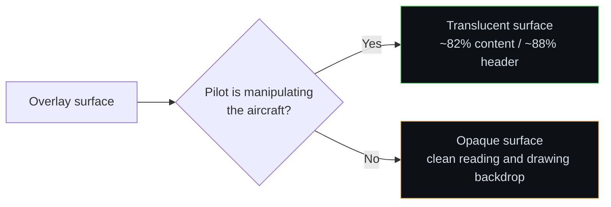

# Pilot, Instructor, and Panel Rules

This document defines the panel model for the simulator workspace:

- **Docked** panels own layout space.
- **Overlay** panels borrow attention without reflowing the layout.
- **Tabs** select between alternative views inside one panel; they are not an independent visibility mechanism.

## 1. Choose the panel pattern

| Pattern | Owns layout space               | Visibility control                      | Use for                                                    |
| ------- | ------------------------------- | --------------------------------------- | ---------------------------------------------------------- |
| Docked  | Yes                             | Independent toggle or fixed layout slot | Continuous monitoring and side-by-side comparison          |
| Overlay | No, it covers the cockpit       | HUD toggle / close button               | Focused tools that would otherwise squeeze the base layout |
| Tabs    | No, it shares an existing panel | Tab selection                           | True alternatives that cannot be visible together          |

## 2. Pilot layout

### Pilot docked surfaces

| Surface   | Toggle         | Rules                    |
| --------- | -------------- | ------------------------ |
| Cockpit   | Always visible | Base flight view         |
| Autopilot | `A/P`          | Independent docked panel |
| Console   | `CONSOLE`      | Independent docked panel |
| Plots     | `PLOTS`        | Independent docked panel |

The cockpit column is fixed at `62%`; the teaching deck is `38%`. The deck exists while either Console or Plots is visible. Docked toggles do not affect overlay visibility.

## 3. Pilot overlay rules

### Overlay groups

| Group   | Members                                        | Exclusivity                      | Placement                                                                          |
| ------- | ---------------------------------------------- | -------------------------------- | ---------------------------------------------------------------------------------- |
| Primary | Controls/Joystick, Lessons, Airport, Classroom | One at a time                    | Controls, Airport and Classroom are right-side drawers; Lessons covers the cockpit |
| Tool    | Airflow, Whiteboard                            | Independent; both can be visible | Over the cockpit; side-by-side above `1280px`, stacked at or below `1280px`        |

### Cross-group rules

1. Opening a primary overlay closes Airflow and Whiteboard.
2. Opening Airflow or Whiteboard closes the primary overlay.
3. Airflow and Whiteboard can be open together.
4. The HUD stays above all overlays and remains available.
5. The deck remains visible while overlays cover the cockpit.
6. Tool panels have their own close button.
7. In Pilot, Airflow and Whiteboard tabs are hidden; they are accessed through the HUD.
8. Starting a lesson closes the Lessons overlay, opens Console, and selects the Console tab.

### HUD active states

| HUD button                                | Reflects                   |
| ----------------------------------------- | -------------------------- |
| `CONSOLE`, `PLOTS`, `A/P`                 | Docked panel visibility    |
| `AIRFLOW`, `BOARD`                        | Tool overlay visibility    |
| `CONTROLS`, `LESSONS`, `AIRPORT`, `CLASS` | Primary overlay visibility |

## 4. Instructor layout

### Instructor rules

1. Instructor is a fixed three-column dashboard; it has no Pilot HUD and no Pilot overlays.
2. Panels are visible through the layout preset; the simulation panel is hidden (`0`).
3. Airflow remains a tab in the Flight Data panel.
4. Whiteboard remains a tab in the Prompt panel.
5. Controls, Airport and Joystick are tabs in the Flight Model panel.
6. `setTab()` dispatches directly to the target panel in Instructor.
7. Switching layouts closes Pilot overlays and tool panels.
8. `setPilotView()` does not alter the Instructor layout.
9. Airport is the middle tab of the Flight Model panel; approaches, datum and layer toggles live there. Its always-visible `LAYERS` grid mirrors the Controls `airport` group, so layer toggles are counted and labelled from the metadata rather than hand-coded. The panel status follows the active tab, so Airport reports the loaded airport (or `NO AIRPORT`) instead of the aircraft type. Placement is a spatial diagram, not a button matrix: the runway strip at the top is the 0 NM threshold target (which stops the aircraft), then distance runs down the left gutter and side across the centreline, with one dot per target at 3/6/9 NM. A muted line above the strip carries course, glideslope and TCH. The 30° intercept sits inside the 90° base turn on each side, and the 3 NM row offers only the final dot because an intercept from there crosses the localizer behind the threshold. The threshold dot is red (`panelActive`). Every button in the panel — world toggle, approach chips, layer toggles — uses the same flat chip style; section labels are quiet ruled captions rather than filled header bars. Approaches are listed by runway designator (06, 09L, 09R, 18, 36R) and the first is selected once the airport loads, so the diagram is never inert without a selection. Runway-end, gate and holding-point placement are no longer offered.

## 5. Tabs and compatibility

Tabs are a containment pattern, not a visibility pattern. In Pilot, independent surfaces must not be hidden behind tabs. The Airport tab is therefore part of the Instructor Flight Model panel only; the Pilot Controls drawer hides it (`hidden-tabs`) because Airport is an independent overlay there.

| Request                  | Pilot behavior           | Instructor behavior    |
| ------------------------ | ------------------------ | ---------------------- |
| `realtime / Airflow`     | Open Airflow overlay     | Select Airflow tab     |
| `realtime / Flight-Data` | Close Airflow overlay    | Select Flight Data tab |
| `prompt / whiteboard`    | Open Whiteboard overlay  | Select Whiteboard tab  |
| `prompt / Console`       | Close Whiteboard overlay | Select Console tab     |
| Other requests           | Dispatch normally        | Dispatch normally      |

## 6. Opacity policy

| Surface                                          | Opacity                     | Reason                                                       |
| ------------------------------------------------ | --------------------------- | ------------------------------------------------------------ |
| Lessons, Whiteboard, Airflow, Classroom, Airport | Opaque                      | Reading, drawing, and focused instruction                    |
| Controls / Joystick surface                      | ~82%                        | Keeps the scene visible while the pilot manipulates controls |
| Controls / Joystick header                       | ~88%                        | Title and controls remain readable                           |
| Buttons, sliders, inputs, labels                 | Opaque                      | Operability and contrast                                     |
| HUD                                              | Translucent + backdrop blur | Always reachable without fully blocking the scene            |

Opacity applies to surface backgrounds only. Text and interactive controls do not become transparent.

## 7. `setPilotView()` priority

| Request                                     | Result                                                                              |
| ------------------------------------------- | ----------------------------------------------------------------------------------- |
| `console`, `plots`, `autopilot`             | Set docked panel visibility independently                                           |
| One primary overlay true                    | Open the last true primary in priority order: Controls, Lessons, Airport, Classroom |
| Airflow / Whiteboard true without a primary | Close the primary overlay and apply tool flags                                      |
| Airflow and Whiteboard both true            | Open both tool overlays                                                             |
| Primary and tool both true                  | Primary wins; tools are closed                                                      |
| `attention`                                 | Direct the pilot's attention without changing the overlay rules                     |
